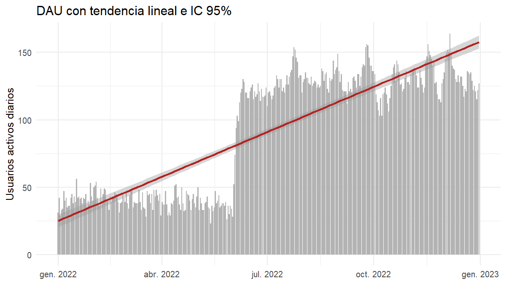
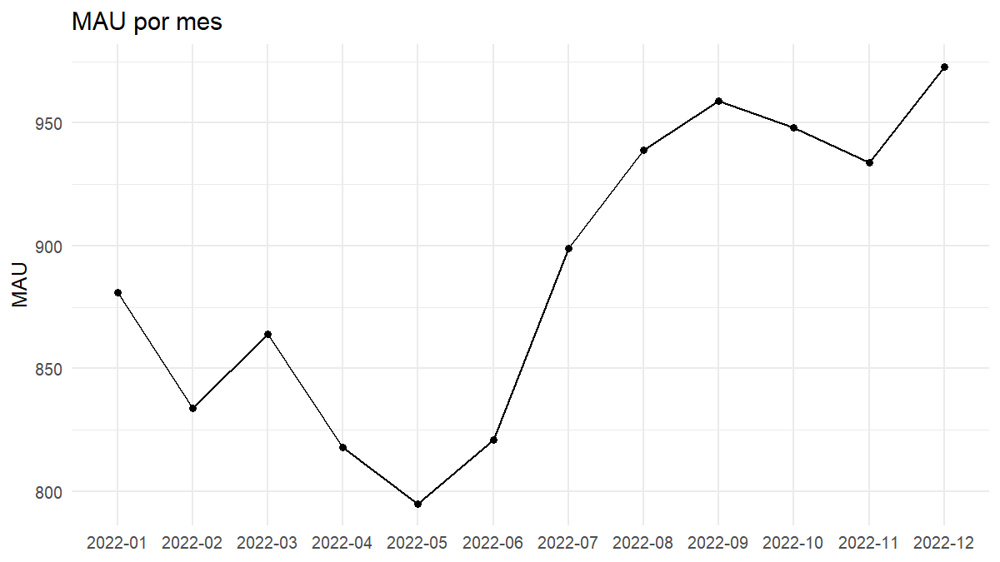
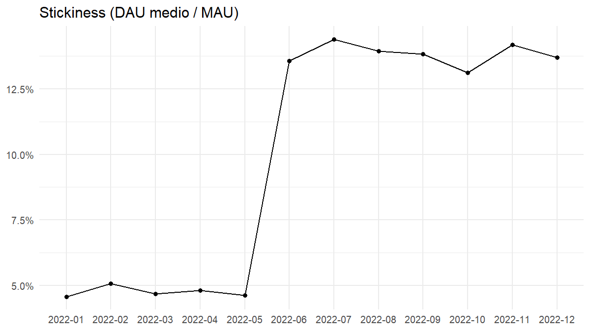
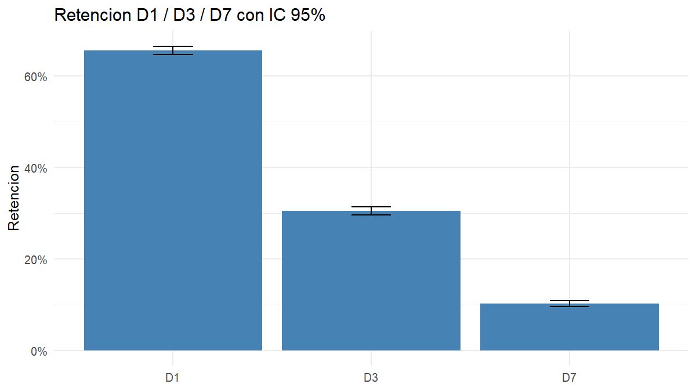
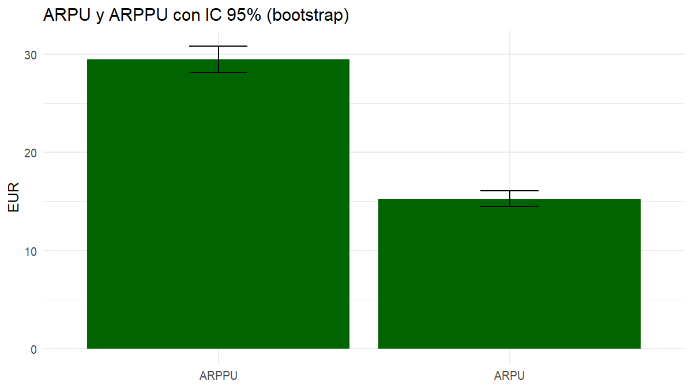
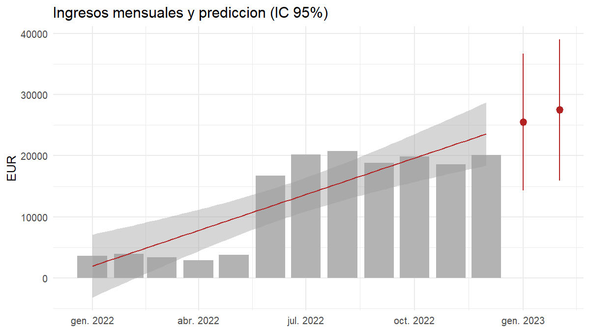
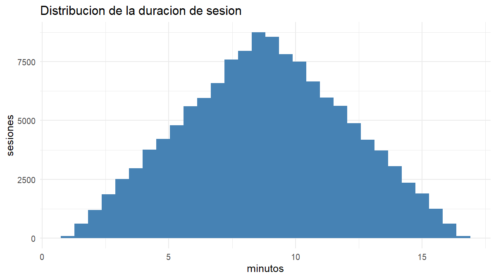
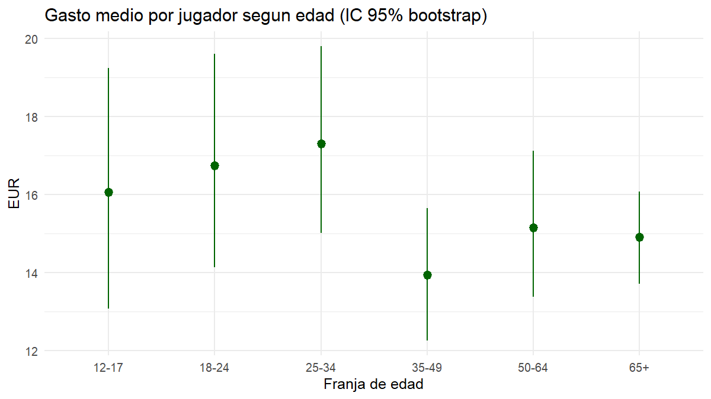

# Delivery 1 – KPIs (Game Analytics)

Pipeline de analítica de juego construido de principio a fin: un cliente **Unity** que simula jugadores,
un servidor **PHP** que recibe los eventos, una base de datos **MySQL/MariaDB** donde se almacenan y un
análisis estadístico en **R** con intervalos de confianza.

```
Unity (Simulator + AnalyticsService) ──HTTP POST──▶ PHP ──▶ MySQL ──▶ SQL (KPIs) ──▶ R (IC, tests, gráficos)
```

## Contenido del repositorio

```
Delivery1_Simulator/                         Proyecto de Unity
  Assets/_Scripts/Analytics/                 Scripts de analítica (recogida y envío de datos)
Server/
  server/                                    Scripts PHP que insertan los eventos en MySQL
  sql/01_schema.sql                          Esquema de la base de datos
  sql/02_kpi_queries.sql                     Consultas SQL de los KPIs (cada una con su "-- name:")
  r/analysis.R                               Análisis estadístico y gráficos
  r/output/                                  Gráficos y kpi_summary.csv generados por R
Statement/  Items/                           Enunciado y catálogo de items entregados con el ejercicio
```

El `Simulator.cs`, `AllCountries.cs` y el `AnalyticsManager.cs` originales entregados con el ejercicio **no se han modificado**.

---

## 1. Modelo de datos y por qué se estructura así

```
countries (1)───(N) players (1)───(N) sessions (1)───(N) purchases (N)───(1) items
```

| Tabla | Campos principales | Decisión de diseño |
|---|---|---|
| `countries` | `country_id`, `name` (único) | El país es un catálogo: se guarda una vez y los jugadores solo referencian su id, sin repetir texto. |
| `items` | `item_id`, `price` | Catálogo de productos con su precio (Items.xlsx). El precio vive en un solo sitio: si cambia, los ingresos se recalculan sin tocar las compras. |
| `players` | `player_id`, `name`, `country_id`, `age`, `gender`, `join_date` | Datos demográficos fijos del jugador, registrados una sola vez. |
| `sessions` | `session_id`, `player_id`, `start_date`, `end_date` | Una fila por sesión. `end_date` es `NULL` mientras la sesión sigue abierta; así se registra el inicio al instante y el cierre después. |
| `purchases` | `purchase_id`, `session_id`, `item_id`, `purchase_date` | Una fila por compra, ligada a la sesión (y por ella al jugador). |

**Por qué así**
- **Normalizado (3NF):** cada dato se guarda una sola vez; no hay columnas repetidas ni cálculos almacenados (los ingresos se derivan de `purchases` + `items`).
- **Tablas atómicas:** jugador, sesión y compra son entidades distintas con cardinalidad 1-N, lo que permite calcular DAU, retención o ARPU con simples JOIN.
- **Integridad:** claves primarias y foráneas en todas las relaciones (InnoDB).
- **Escalable:** índices en las columnas por las que se filtra y agrupa (`join_date`, `start_date`, `(player_id, start_date)`, `purchase_date`, `session_id`).
- **Ampliable:** nuevos eventos (niveles, tutorial…) se añaden como tablas nuevas ligadas a `sessions`, sin tocar las existentes.

## 2. Recogida y almacenamiento de datos

**Unity (`Delivery1_Simulator/Assets/_Scripts/Analytics/`)**
- `AnalyticsService` escucha los eventos del Simulator y los envía por HTTP de forma **asíncrona** (corrutinas), sin bloquear el juego. Se crea solo al iniciar la escena y desactiva en tiempo de ejecución el `AnalyticsManager` original para evitar envíos duplicados.
- Responsabilidades separadas (SOLID): `IAnalyticsTransport` / `HttpAnalyticsTransport` (cómo se envía), `AnalyticsForms` (qué campos lleva cada evento), `OfflineIdProvider` (ids locales si el servidor cae) y `AnalyticsSettings` (configuración).
- Transmisión **no intrusiva**: timeout de 10 s y hasta 2 reintentos con espera creciente; los errores 4xx no se reintentan. Si el servidor no responde, el juego continúa con ids locales reservados (≥ 2.000.000.000) que nunca chocan con los reales y cuyos eventos no se envían.

**Servidor (`Server/server/`)**
- Un endpoint PHP por evento (`add_player`, `add_session`, `add_purchase`, `end_session`) con código común en `common.php`.
- **Consultas preparadas** (sin riesgo de inyección SQL) y **validación** de cada parámetro; cada inserción devuelve el id nuevo, que Unity usa en el siguiente evento.

## 3. KPIs, intervalos de confianza y predicciones

Simulación ejecutada: **10.000 jugadores, 128.624 sesiones y 12.979 compras**, sin ninguna sesión sin cerrar.
Todos los intervalos son al 95 %.

### Definiciones (`Server/sql/02_kpi_queries.sql`)
- **DAU / MAU:** jugadores distintos con alguna sesión que empieza ese día / ese mes.
- **Stickiness:** DAU medio del mes / MAU del mes.
- **Retención Dn:** el jugador vuelve exactamente el día *n* después de unirse. Solo se cuentan jugadores cuyo día *n* cae dentro del periodo con datos.
- **ARPU:** ingresos / jugadores. **ARPPU:** ingresos / jugadores que pagan. **Conversión:** jugadores que pagan / jugadores.
- **Sesiones:** número por jugador y duración (`TIMESTAMPDIFF`).
- Convención: cada evento pertenece al día en que **empieza** su sesión.

### Resultados

| KPI | Valor | IC 95 % | Método |
|---|---|---|---|
| Retención D1 | 65,6 % | 64,6 – 66,5 % | Wilson |
| Retención D3 | 30,5 % | 29,6 – 31,4 % | Wilson |
| Retención D7 | 10,2 % | 9,6 – 10,8 % | Wilson |
| ARPU | 15,27 € | 14,51 – 16,07 € | Bootstrap |
| ARPPU | 29,49 € | 28,12 – 30,87 € | Bootstrap |
| Conversión a pagador | 51,8 % | 50,8 – 52,8 % | Wilson |
| Duración de sesión | 529 s (≈ 8,8 min) | 528 – 530 s | t de Student |
| Sesiones por jugador | 12,9 | 12,5 – 13,2 | t de Student |

El ARPU y el ARPPU se calculan con bootstrap porque el gasto por jugador está muy sesgado.

### Gráficos









### Tendencia y predicción
- **DAU:** crece **0,36 usuarios/día** (IC 0,34 – 0,39; p < 0,001). Es coherente con que cada mes se incorporan jugadores nuevos y con que, desde junio, el simulador sube la probabilidad de volver a jugar del 70 % al 95 %.
- **Ingresos mensuales:** tendencia lineal de **+1.969 €/mes** (IC 1.173 – 2.765).
  Predicción de los dos meses siguientes (intervalo de predicción 95 %): **25.526 €** (14.347 – 36.705) y **27.495 €** (15.925 – 39.064).
  El intervalo es ancho porque el modelo se ajusta con solo 12 puntos mensuales.

### ¿Hay tendencias demográficas?
No. Con 10.000 jugadores ningún contraste es significativo, y por tanto no hay evidencia de diferencias entre grupos:

| Contraste | p-valor |
|---|---|
| Retención D1 por franja de edad (Fisher) | 0,279 |
| Retención D1 por grupo de género (Fisher) | 0,866 |
| Retención D1 por país (Fisher) | 0,643 |
| ARPU por franja de edad (Kruskal-Wallis) | 0,254 |
| ARPU por género (Wilcoxon) | 0,948 |
| ARPU por país (Kruskal-Wallis) | 0,428 |
| Correlación edad–gasto (Spearman, ρ = 0,0007) | 0,945 |
| Conversión a pagador por edad (χ²) | 0,321 |

Es el resultado esperable en datos simulados: edad, género y país se generan al azar y no influyen en el comportamiento.

## 4. Fortalezas y limitaciones

**Fortalezas**
- Esquema normalizado, con integridad referencial e índices.
- Envío asíncrono y tolerante a fallos: el juego nunca se bloquea ni se queda esperando al servidor.
- Código modular y desacoplado; el contrato con el servidor está en un solo fichero (`AnalyticsForms.cs`).
- Consultas SQL independientes (no requieren permisos de `CREATE VIEW`) y reutilizadas por R desde una única fuente.
- Análisis con intervalos de confianza, tests de hipótesis, bootstrap y una predicción con su incertidumbre.

**Limitaciones**
- **Datos sintéticos:** el simulador asigna edad, género y país al azar; por eso no aparecen tendencias demográficas reales.
- **Solo 2 países** en esta ejecución (el simulador elige al azar entre 1 y 9 al arrancar), así que la comparación por país es débil.
- **Género:** el simulador envía un número entre 0 y 1; se parte en dos grupos (< 0,5 y ≥ 0,5) como supuesto de trabajo.
- **Escalabilidad del envío:** una petición HTTP por evento y de una en una. Para un juego real habría que agrupar eventos en lotes y usar una cola.
- **Reintentos:** si una petición expira pero el servidor sí la insertó, el reintento puede duplicar un registro (no es idempotente).
- **Servidor:** cada petición abre su propia conexión a la base de datos; con mucho tráfico convendría un pool de conexiones.
- **Predicción:** solo 12 puntos mensuales, de ahí el intervalo ancho; no capta estacionalidad.
- **Retención exacta al día N:** es más estricta que la retención "al día N o después".

## 5. Cómo reproducirlo

1. **Base de datos:** ejecuta `Server/sql/01_schema.sql` (MySQL Workbench o phpMyAdmin) sobre tu base de datos.
2. **Servidor:** edita `Server/server/config.php` con las credenciales de tu base de datos (`DB_USER`, `DB_PASS`, `DB_NAME`) y sube los PHP de `Server/server/` a tu carpeta pública (`public_html`) por SFTP.
3. **Unity:** abre `Delivery1_Simulator` con Unity (los scripts de analítica ya están en `Assets/_Scripts/Analytics/`). Si cambia la URL del servidor, edítala en `AnalyticsSettings.cs`. Sube `Max Players` en el objeto Simulator y dale a Play.
4. **Análisis:** en RStudio, con `setwd("Server/r")`:
   ```r
   install.packages(c("DBI", "RMariaDB", "ggplot2", "scales", "Hmisc"))
   Sys.setenv(GA_HOST = "tu_servidor", GA_USER = "tu_usuario", GA_PASS = "tu_contraseña", GA_DB = "tu_base_de_datos")
   source("analysis.R")
   ```
   Genera los gráficos y `kpi_summary.csv` en `Server/r/output/`.

> El servidor solo es accesible desde la red de la universidad o por VPN.